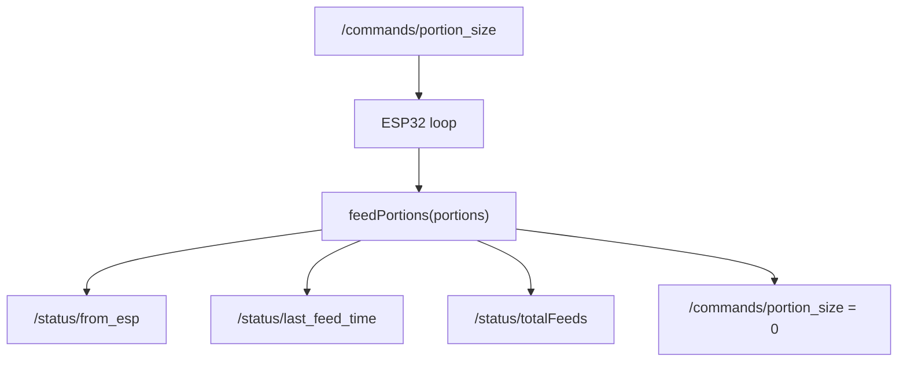

# API

## Current App API

The Expo app does not call any external API. It imports local mock data from `petfeeder/data/mock-data.ts`.

## Current Firmware API

The firmware communicates with Firebase Realtime Database through the Arduino Firebase client.

Implemented paths:

| Path | Direction | Type | Purpose |
| --- | --- | --- | --- |
| `/commands/portion_size` | read and reset | integer | Number of portions to dispense. Values greater than zero trigger feeding. |
| `/status/from_esp` | write | string | Device state, currently `feeding` or `idle`. |
| `/status/last_feed_time` | write | string | Last feeding timestamp formatted as `YYYY-MM-DD HH:mm:ss`. |
| `/status/totalFeeds` | read and write | integer | Running total incremented by the number of portions dispensed. |

## Planned App Contract

`petfeeder/AGENTS.md` contains a planned Firebase RTDB schema with users, feeders, settings, schedules, feed commands, feed history, and alerts. That schema is not implemented in code.

Before connecting the app, choose one contract:

- Adapt firmware to the planned app schema.
- Adapt the app to the firmware's current flat `/commands` and `/status` schema.
- Introduce a migration path that supports both temporarily.

## External Services

- Firebase Realtime Database is used by firmware.
- NTP service `pool.ntp.org` is used by firmware.
- Expo services may be used by app development tooling, but no project-specific cloud deployment is configured.

