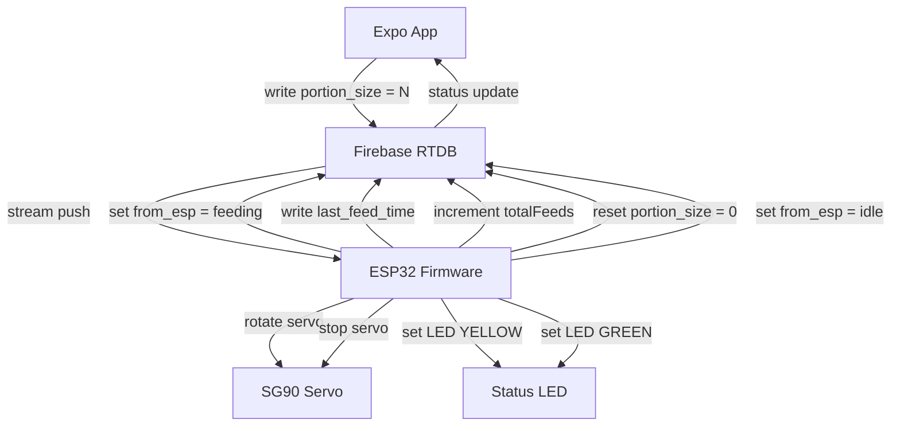

# API

## Current App API

The Expo app does not call any external API. It imports local mock data from `petfeeder/data/mock-data.ts`.

**Planned:** App will use Firebase SDK to read/write Firebase RTDB. See Phase 2 in [Roadmap](Roadmap.md).

## Firmware API (Firebase RTDB)

The firmware communicates with Firebase Realtime Database through the Arduino Firebase client using **streaming** (not polling).

### Implemented Paths

| Path | Direction | Type | Written By | Read By | Purpose |
| --- | --- | --- | --- | --- | --- |
| `/commands/portion_size` | write (app) / stream (ESP32) | integer | App | ESP32 | Number of portions to dispense (1-10). Values > 0 trigger feeding. ESP32 resets to 0 after completion. |
| `/status/from_esp` | write (ESP32) / read (app) | string | ESP32 | App | Device state: `"idle"` or `"feeding"`. |
| `/status/last_feed_time` | write (ESP32) / read (app) | string | ESP32 | App | Last feeding timestamp: `YYYY-MM-DD HH:mm:ss`. |
| `/status/totalFeeds` | write (ESP32) / read (app) | integer | ESP32 | App | Running total of portions dispensed since power-on. |
| `/status/lastSeenAt` | write (ESP32) / read (app) | integer | ESP32 | App | Unix timestamp (ms) of last heartbeat. App considers device offline if > 30s old. |

### Command Flow



### Streaming vs Polling

| Method | Current | Planned |
| --- | --- | --- |
| ESP32 reads commands | Polling every 1s | Streaming (persistent HTTP) |
| Latency | 1-2 seconds | < 500ms |
| WiFi traffic | Constant | Event-driven |
| Reliability | Depends on poll interval | Auto-reconnect, TCP KeepAlive |

### Firebase ESP32 Client API Calls

```cpp
// Streaming setup
FirebaseData stream;
FirebaseData fbdo;

Firebase.RTDB.beginStream(&stream, "/commands/portion_size");
Firebase.RTDB.setStreamCallback(&stream, streamCallback, streamTimeoutCallback);

// Stream callback
void streamCallback(FirebaseStream data) {
    if (data.eventType() == "put" || data.eventType() == "patch") {
        if (data.dataType() == "int") {
            pendingPortions = data.intData();
            commandReceived = true;
        }
    }
}

// Timeout callback
void streamTimeoutCallback(bool timeout) {
    if (timeout) Serial.println("Stream timeout - auto-reconnecting");
}

// Read/write (non-streaming)
Firebase.RTDB.setString(&fbdo, "/status/from_esp", "feeding");
Firebase.RTDB.getInt(&fbdo, "/status/totalFeeds");
Firebase.RTDB.setInt(&fbdo, "/status/totalFeeds", newValue);
```

### LED Status Paths

The LED is controlled locally on the ESP32, not through Firebase. Firebase status reflects the LED state:

| LED State | Firebase `from_esp` Value |
| --- | --- |
| GREEN (idle) | `"idle"` |
| YELLOW (feeding) | `"feeding"` |
| RED (error) | `"error"` (future) |

## App API (Planned)

Phase 2 will add Firebase SDK to the Expo app:

```typescript
// petfeeder/lib/firebase.ts
import { initializeApp } from 'firebase/app';
import { getDatabase, ref, set, onValue } from 'firebase/database';

const firebaseConfig = {
  // from environment variables
};

const app = initializeApp(firebaseConfig);
const db = getDatabase(app);

// Send command
export async function feedNow(portions: number) {
  const cmdRef = ref(db, 'commands/portion_size');
  await set(cmdRef, portions);
}

// Subscribe to status
export function onStatusChange(callback: (status: string) => void) {
  const statusRef = ref(db, 'status/from_esp');
  return onValue(statusRef, (snapshot) => {
    callback(snapshot.val());
  });
}
```

## External Services

- Firebase Realtime Database - command/status transport
- NTP service `pool.ntp.org` - timestamp generation
- Expo services - development tooling (no production deployment)

## Security Rules (Minimal)

```json
{
  "rules": {
    "commands": {
      ".read": "auth != null",
      ".write": "auth != null"
    },
    "status": {
      ".read": "auth != null"
    }
  }
}
```

**Note:** Authentication is not yet implemented. Start with Firebase Anonymous auth for single-user prototype.
