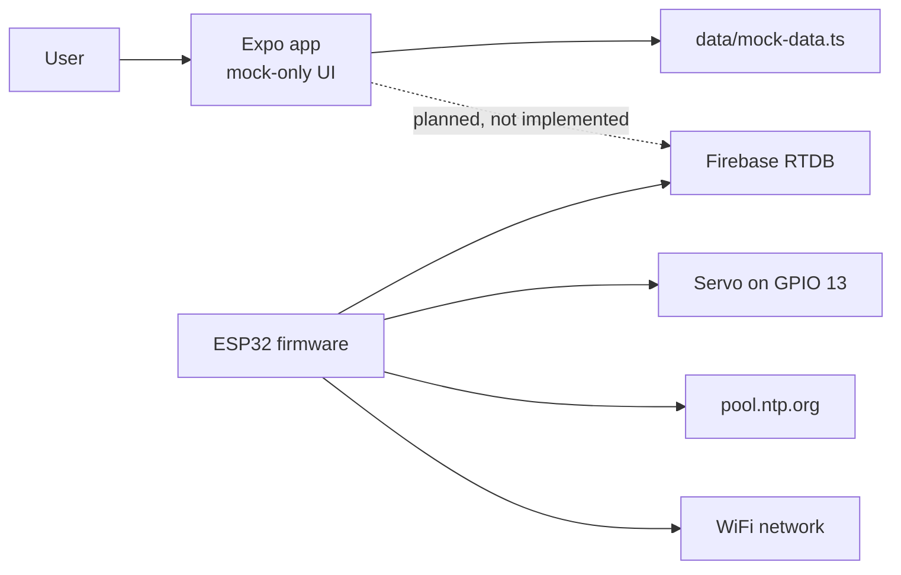
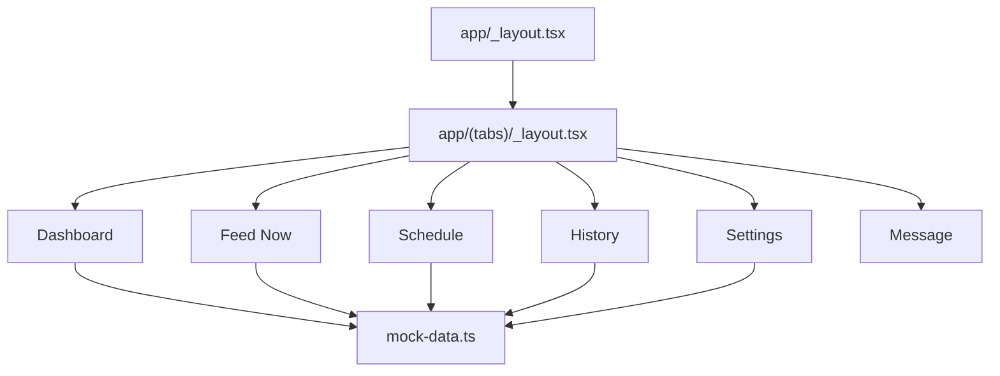
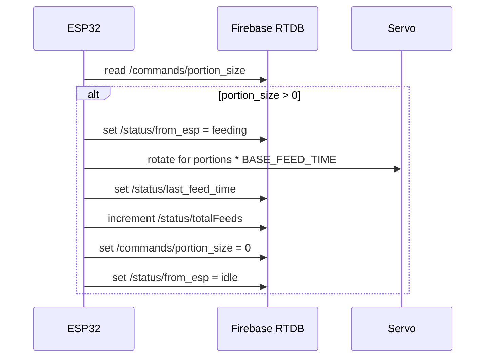

# Architecture

## Overview

Smart PetFeeder currently has three major parts:

- Mobile app prototype: React Native Expo app under `petfeeder/`.
- Device firmware: ESP32 Arduino sketches at the repository root.
- Mechanical assets: 3D printing test files under `Printing Files/TESTING/`.

The mobile app and firmware are not yet integrated. The app uses local mock data only, while the firmware reads and writes Firebase Realtime Database directly.

## Mobile App Architecture

The app uses Expo Router file-based routing.

- `petfeeder/app/_layout.tsx` creates the root stack and applies React Navigation themes.
- `petfeeder/app/(tabs)/_layout.tsx` defines the bottom tab navigator.
- Tab screens read from `petfeeder/data/mock-data.ts` and manage simple local state with React hooks.
- `petfeeder/components/app-screen.tsx` provides the common safe-area and scrollable screen layout.
- `petfeeder/components/info-card.tsx` provides repeated status card UI.
- `petfeeder/constants/theme.ts` defines light and dark color values used by navigation and themed helpers.

## Firmware Architecture

Both Arduino sketches are nearly identical. They:

- Connect an ESP32 to WiFi.
- Authenticate to Firebase using hard-coded credentials.
- Configure NTP time using `pool.ntp.org` and UTC+5:30.
- Attach a servo to GPIO 13.
- Poll `/commands/portion_size` every second.
- If the portion size is positive, rotate the servo, write status, log the last feed time, increment `/status/totalFeeds`, reset the command, and return to idle.

## Current Integration Gap

The app does not call Firebase, does not issue `/commands/portion_size`, and does not read `/status`. Future integration must reconcile the app's planned schema in `petfeeder/AGENTS.md` with the firmware's current flat `/commands` and `/status` paths.

