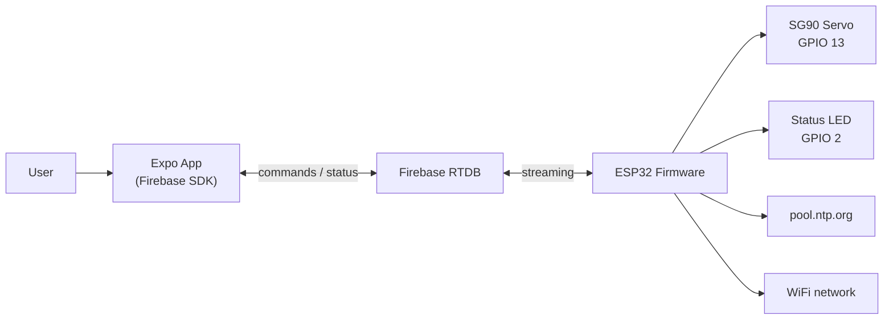
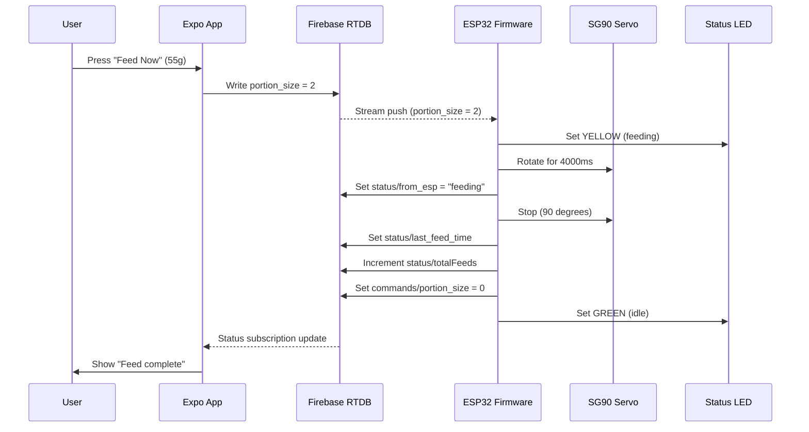
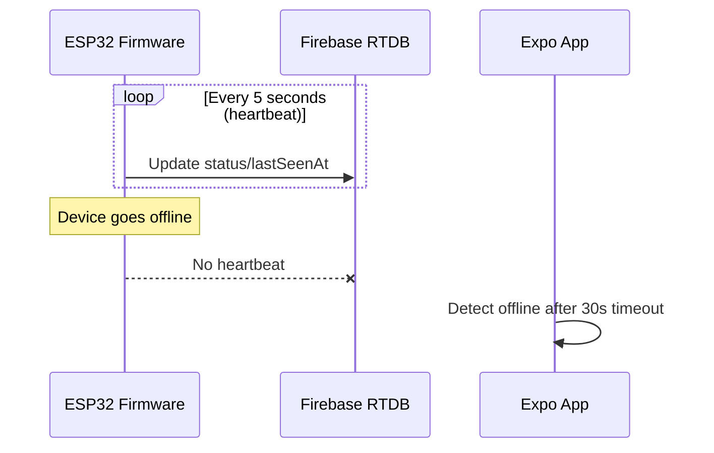
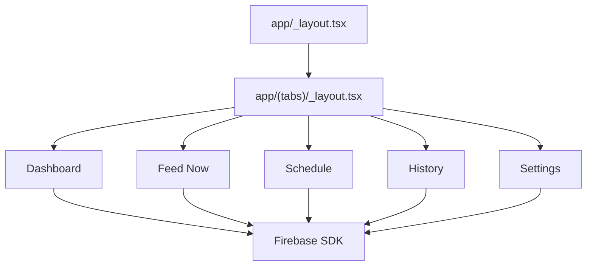
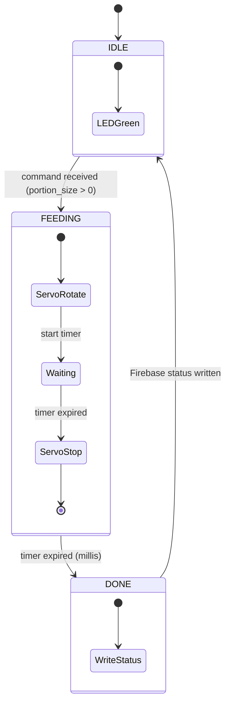

# Architecture

## Overview

Smart PetFeeder has three major parts:

- Mobile app: React Native Expo app under `petfeeder/`.
- Device firmware: ESP32 Arduino sketch using Firebase RTDB streaming.
- Mechanical assets: 3D printing test files under `Printing Files/TESTING/`.

The app communicates with the ESP32 through Firebase Realtime Database. The firmware streams commands from Firebase and writes status back. A status LED on the ESP32 provides local visual feedback.

## System Architecture



## Data Flow

### Command Flow (App → ESP32)



### Status Flow (ESP32 → App)



## Mobile App Architecture

The app uses Expo Router file-based routing.

- `petfeeder/app/_layout.tsx` creates the root stack and applies React Navigation themes.
- `petfeeder/app/(tabs)/_layout.tsx` defines the bottom tab navigator.
- Tab screens read from `petfeeder/lib/firebase.ts` for real-time data.
- `petfeeder/components/app-screen.tsx` provides the common safe-area and scrollable screen layout.
- `petfeeder/components/info-card.tsx` provides repeated status card UI.
- `petfeeder/constants/theme.ts` defines light and dark color values used by navigation and themed helpers.



## Firmware Architecture

The ESP32 firmware uses:

- Firebase RTDB streaming (not polling) for instant command reception.
- Non-blocking servo control using `millis()` state machine.
- Status LED for local visual feedback.
- NTP time for timestamps.
- `secrets.h` for credentials (not committed to Git).

### Firmware State Machine

```
┌─────────┐   command received   ┌──────────┐   timer expired   ┌────────┐
│  IDLE   │─────────────────────►│ FEEDING  │──────────────────►│  DONE  │
│ (GREEN) │                      │ (YELLOW) │                    │        │
└─────────┘◄─────────────────────└──────────┘                    └────────┘
                            reset command                         │
                            write status                          │
                            set LED GREEN ────────────────────────┘
```



### Non-Blocking Servo Control

The current blocking `delay()` approach is replaced with a state machine:

| State | Action | Duration |
| --- | --- | --- |
| IDLE | LED GREEN, wait for command | Indefinite |
| FEEDING | Servo rotate to 0, LED YELLOW | portions × 2000ms |
| DONE | Stop servo, write Firebase status, LED GREEN | Single loop iteration |

The `loop()` runs continuously:
1. `Firebase.ready()` - handles token refresh
2. Check stream callback flag - trigger feed if command received
3. `updateFeeder()` - check state machine, stop servo when timer expires

### Firebase Streaming

Instead of polling every second, the firmware opens a persistent HTTP connection:

```cpp
// Setup: open stream on command path
Firebase.RTDB.beginStream(&stream, "/commands/portion_size");
Firebase.RTDB.setStreamCallback(&stream, streamCallback, streamTimeoutCallback);

// Callback: set flag when command arrives
void streamCallback(FirebaseStream data) {
    if (data.eventType() == "put") {
        pendingPortions = data.intData();
        commandReceived = true;
    }
}

// Loop: no polling needed
void loop() {
    Firebase.ready();
    if (commandReceived) {
        commandReceived = false;
        startFeeding(pendingPortions);
    }
    updateFeeder(); // non-blocking state machine
}
```

## Current Integration Status

| Component | Status | Notes |
| --- | --- | --- |
| ESP32 → Firebase | Implemented | Polling (to be changed to streaming) |
| App → Firebase | Not implemented | App uses mock data |
| App ← Firebase | Not implemented | No real-time status |
| LED | Not implemented | Wiring and code needed |
| Credential security | Not implemented | Hard-coded in source |

## Files to Modify/Create

| File | Action | Purpose |
| --- | --- | --- |
| `PetFeeder.ino` | Rewrite | Streaming, state machine, LED |
| `secrets.h` | Create | Credentials (gitignored) |
| `petfeeder/lib/firebase.ts` | Create | Firebase SDK init |
| `petfeeder/app/(tabs)/feed-now.tsx` | Modify | Firebase write |
| `petfeeder/app/(tabs)/index.tsx` | Modify | Real-time subscriptions |
| `.gitignore` | Modify | Add secrets.h |
