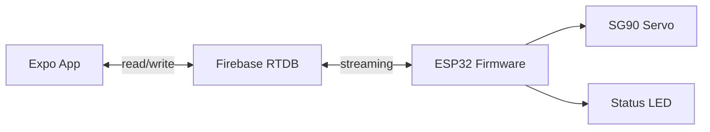

# Database

## Current State

The app uses `petfeeder/data/mock-data.ts` for local mock data. The firmware uses Firebase Realtime Database directly.

## Firebase RTDB Schema

The firmware uses a flat schema under the root. The app reads and writes to the same paths.

```json
{
  "commands": {
    "portion_size": 0
  },
  "status": {
    "from_esp": "idle",
    "last_feed_time": "YYYY-MM-DD HH:mm:ss",
    "totalFeeds": 0,
    "lastSeenAt": 1764547200000
  }
}
```

### Path Definitions

| Path | Type | Written By | Read By | Purpose |
| --- | --- | --- | --- | --- |
| `/commands/portion_size` | integer | App | ESP32 (stream) | Number of portions to dispense (1-10). Values > 0 trigger feeding. ESP32 resets to 0 after completion. |
| `/status/from_esp` | string | ESP32 | App | Device state: `"idle"` or `"feeding"`. |
| `/status/last_feed_time` | string | ESP32 | App | Timestamp of last feed: `YYYY-MM-DD HH:mm:ss`. |
| `/status/totalFeeds` | integer | ESP32 | App | Running total of portions dispensed since power-on. |
| `/status/lastSeenAt` | integer | ESP32 | App | Unix timestamp (ms) of last heartbeat. App considers device offline if older than 30s. |

### Command Lifecycle

```
App writes portion_size = N
        │
        ▼
ESP32 stream receives N
        │
        ▼
ESP32 sets from_esp = "feeding"
        │
        ▼
ESP32 rotates servo for N × 2000ms
        │
        ▼
ESP32 stops servo
        │
        ▼
ESP32 writes last_feed_time
ESP32 increments totalFeeds
ESP32 sets portion_size = 0
ESP32 sets from_esp = "idle"
        │
        ▼
App receives status update
```

### Timestamp Format

- `last_feed_time`: Formatted string `YYYY-MM-DD HH:mm:ss` (local timezone).
- `lastSeenAt`: Unix milliseconds for easy comparison with JavaScript `Date.now()`.

## Mock App Data

`petfeeder/data/mock-data.ts` exports:

- `mockFeederStatus` - battery level, online state, food level, remaining grams, last sync, and pet name.
- `mockSchedules` - schedule ID, days, enabled flag, label, portion grams, and display time.
- `mockHistory` - feed events with date, time, source, status, pet name, and portion grams.
- `mockSettings` - alerts, feeder name, alert threshold, default portion, quiet hours, and timezone.

**Note:** Mock data is kept for UI development and testing. Real data comes from Firebase.

## Data Flow



## Security Rules (Minimal)

```json
{
  "rules": {
    "commands": {
      ".read": "auth != null",
      ".write": "auth != null"
    },
    "status": {
      ".read": "auth != null",
      ".write": "auth != null"
    }
  }
}
```

**Note:** Authentication is planned but not yet implemented. Start with Firebase Anonymous auth for single-user prototype.

## Future Schema Expansion

When adding features, expand the schema:

```json
{
  "commands": { "portion_size": 0 },
  "status": {
    "from_esp": "idle",
    "last_feed_time": "...",
    "totalFeeds": 0,
    "lastSeenAt": 0
  },
  "schedules": {
    "{scheduleId}": {
      "label": "Breakfast",
      "time": "07:30",
      "days": ["mon", "tue", "wed", "thu", "fri"],
      "portionGrams": 55,
      "enabled": true
    }
  },
  "history": {
    "{historyId}": {
      "timestamp": 0,
      "portionGrams": 55,
      "source": "manual",
      "status": "completed"
    }
  }
}
```

**Deferred:** Multi-user ownership, user profiles, alerts, and advanced features. Focus on single-device single-user first.
