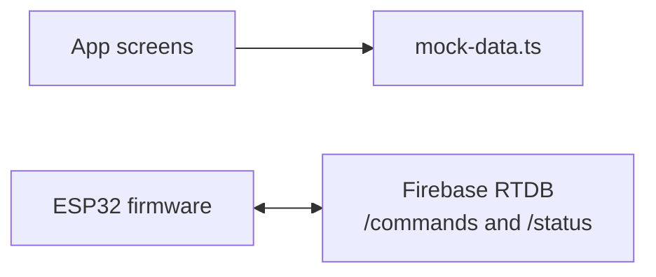

# Database

## Current State

There is no app-side database integration. The app uses `petfeeder/data/mock-data.ts`.

The firmware uses Firebase Realtime Database directly. The current implemented schema is:

```json
{
  "commands": {
    "portion_size": 0
  },
  "status": {
    "from_esp": "idle",
    "last_feed_time": "YYYY-MM-DD HH:mm:ss",
    "totalFeeds": 0
  }
}
```

## Mock App Data

`petfeeder/data/mock-data.ts` exports:

- `mockFeederStatus` - battery level, online state, food level, remaining grams, last sync, and pet name.
- `mockSchedules` - schedule ID, days, enabled flag, label, portion grams, and display time.
- `mockHistory` - feed events with date, time, source, status, pet name, and portion grams.
- `mockSettings` - alerts, feeder name, alert threshold, default portion, quiet hours, and timezone.

## Planned Schema

The nested `petfeeder/AGENTS.md` documents a more complete planned Firebase RTDB schema for:

- `users`
- `feeders`
- `settings`
- `schedules`
- `feedCommands`
- `feedHistory`
- `alerts`

That schema is a design note, not running code.

## Data Flow Today



## Required Decisions

- Choose a canonical Firebase schema.
- Define timestamp format. Firmware currently writes formatted strings; the planned app schema uses Unix milliseconds.
- Define command lifecycle states.
- Define ownership and security rules before adding real users.
- Define how device identity maps to app users and feeders.

